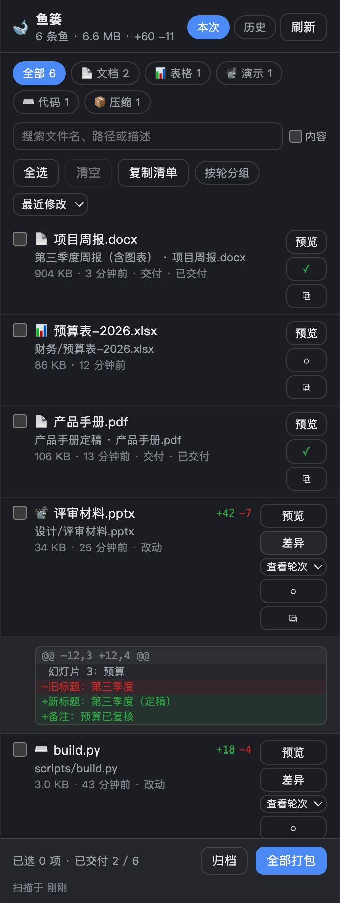
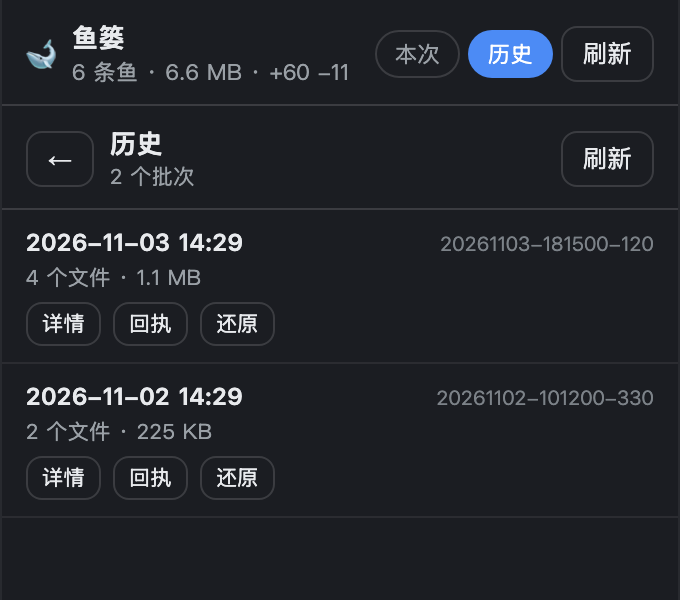

<div align="center">

# 🐋 深海鱼篓

### dsh-whale-catch · 让本场会话的交付物自己游进篮子

**自动收集 · 就地预览 / 差异 · 交付台账 · 体检 · 回执 · 还原 · 内容搜索**

[](https://github.com/Rosynb666/dsh-whale-catch/actions/workflows/ci.yml)
[](https://github.com/Rosynb666/dsh-whale-catch/actions/workflows/release.yml)
[](https://www.npmjs.com/package/dsh-whale-catch)
[](https://www.npmjs.com/package/dsh-whale-catch)
[](https://github.com/Rosynb666/dsh-whale-catch/stargazers)
[](https://github.com/Rosynb666/dsh-whale-catch/blob/main/LICENSE)
[](#limits)
[](#limits)
[-blue?style=flat-square)](#dev)
[](#dev)

[🚀 快速开始](#install) · [✨ 功能地图](#features) · [⚙️ 配置](#config) · [🛡️ 安全模型](#security) · [English](https://github.com/Rosynb666/dsh-whale-catch/blob/main/README.en.md)

</div>

<p align="center">
  
</p>

<p align="center"><sub>🧪 0.4.0 面板静态预览：用 <code>lib/client.js</code> 里真实的面板组件 + 示例数据渲染，不是 DSH 实机截图。顶部「本次 / 历史」、内容搜索、轮次下拉、交付勾选都在图里；实际配色跟随你的主题。</sub></p>

<p align="center">
  
</p>

<p align="center"><sub>🧾 历史视图：每个归档批次都能看详情、下回执、还原；当前视图里的文件还能和归档版对比。</sub></p>

给 [DeepSeek Harness](https://github.com/deepseek-ai/deepseek-harness)（DSH）的右侧栏插件：把一场会话里**产出或改动过的文件**汇总到「鱼篓」里，支持预览、行内差异、版本链、交付台账、交付体检、回执、归档还原、内容搜索、打包 zip 与复制清单。

## 🧭 目录

- [🐋 为什么需要它](#why)
- [✨ 功能地图](#features)
- [🚀 30 秒上手](#install)
- [🖥️ 界面与交互](#ui)
- [🧠 零登记是怎么做到的](#how)
- [⚙️ 配置](#config)
- [🛡️ 安全模型](#security)
- [📊 兼容性与已知限制](#limits)
- [❓ 常见问题](#faq)
- [🛠️ 开发与测试](#dev)
- [🗺️ 路线图](#roadmap)
- [🤝 参与与致谢](#contributing)

---

<a id="why"></a>

## 🐋 为什么需要它

在 DSH 里连续干上几轮活之后，「文件到底产出到哪了」几乎是日常问题：

- 🪟 内核的**产出物卡片**只在当前这一轮出现，往下翻几屏就散了；
- 🐚 在 `bash` 里跑 `python build_doc.py`、`npm run build` 写出来的 docx / pdf / zip，既不算「文件工具改动」，也没调 `present`，两套机制都不认；
- 📦 攒了十几个交付物想一次发给别人，只能回目录里翻，还要担心漏掉；
- 🔍 改过的文件想看看「改了多少、改了什么」，得切回 git 或翻历史。

鱼篓现在管一条线：**自动收**、**一处看**、**交付前体检**、**打包 / 归档 / 回执**、**历史可回看可还原**。改过的文件能就地展开 unified diff、按轮次翻版本、搜正文，都在同一个侧栏里完成。

> 💡 **一句话：** 不改变你的工作流，只给「这一场会话到底产出了什么」一个常驻的答案。

## 🆚 和内核产出物的区别

这不是重复造轮子——内核的 `deliverables/presented` 与 `workspace/changes` 鱼篓照单全收，只是把它们覆盖不到的场景补上：

| | 🪟 内核产出物卡片 | 🧺 鲸鱼鱼篓 |
|---|---|---|
| **来源** | `present` 声明 + git / 文件工具改动 | 同样两条，**再加目录扫描兜底**（bash、python、构建脚本的产物） |
| **范围** | 单轮，轮末出现 | **整场会话**，跨轮聚合 |
| **改动详情** | 轮末卡片里显示一次 | 行数徽章常驻，点开就地看 unified diff，还能按轮分组 |
| **能做什么** | 打开源文件 | 预览 / 看差异 / 搜正文 / 体检 / 打包 / 归档 / 回执 / 还原 / 交付勾选 |
| **Host 重启后** | 改动摘要活在内存里，重启即失 | 文件靠 mtime 重建；`present` 描述与交付状态写进本地台账，重启后回填 |
| **要 agent 配合** | 要模型记得调 `present` | **不要**，零登记 |
| **交付物边界** | 内核认为的「产出」 | 额外兜住「外部进程写进 cwd 的文件」 |

<a id="features"></a>

## ✨ 功能地图

| 能力 | 你会看到什么 |
|---|---|
| 🧺 **自动收集** | `present` 声明、`workspace/changes` 改动、cwd 目录扫描三条来源合并；同一个绝对路径取并集 |
| 👀 **就地预览** | 图片 / PDF / Markdown / 文本 / 源码 / Office 统一在右侧栏用 DSH Document Preview 打开；cwd 外文件会提示复制路径或归档 |
| 🔍 **行内差异** | 对内核记录过的改动展开 unified diff：`+` / `−` 着色、`@@` 段头、新增 / 删除 / binary / oversized 提示 |
| 🧭 **搜索与分组** | 按文件名 / 路径 / 描述搜索；按分类 chip 过滤；按「第 N 轮」分组；复制 Markdown 清单 |
| 📦 **打包 zip** | 只打选中项或全部；包内附 `manifest.json` + `交付清单.md`；cwd 外文件统一 `_external/` |
| 🗂️ **一键归档** | 复制到归档目录，保留相对路径；同名自动 `(2)`；失败逐条回传，不假装成功；同时写批次清单与台账 |
| 🧾 **交付台账** | 「本次 / 历史」双视图：归档批次可回看、可下载回执、可还原、可与当前版本对比 |
| 🩺 **交付体检** | 打包 / 归档前检查缺文件、超大、空文件、敏感文件、改动未归档；block 项拦截，warn 项确认放行 |
| 🔁 **版本链** | 同一个文件改过多次时，可下拉选任意一轮看 diff；归档版与当前版也能对比 |
| 🔎 **内容搜索** | 搜正文，命中行直接跳到 Document Preview 的对应行 |
| ✅ **交付勾选** | 每个文件可标记已交付，底部显示 `已交付 N / M`；状态写进本地台账 |
| 📊 **改动徽章** | 每个文件常驻 `+N −M` 行数；头部汇总本场会话的增删行 |
| 🌗 **跟随主题** | 只用 `--dsw-alias-*` / `--dsw-static-*` 主题 token，深色 / 浅色自动适配 |
| 🌐 **中英双语** | 面板字典中英对齐；错误码有本地化文案 |
| ⚡ **零构建** | `lib/client.js` 原样交给 `__ModuleLoader__`，没有打包步骤 |

### 🎁 0.4.0 亮点

- 🧾 **从收纳篮到交付工作台**：归档会写 `manifest.json` + 本地台账，Host 重启、换会话都能回看；`present` 描述也不再随重启消失。
- 🩺 **交付体检**：缺文件、超大、空文件、敏感文件名 / 文件头密钥模式、归档后改动，打包前一次列清；内容命中只回传模式名与行号。
- 🧾 **交付回执**：自包含 HTML / Markdown，附 sha256，可打印、可核对；API 的 `/ledger/verify` 可重算摘要确认归档文件没被换过。
- 🔁 **版本链与归档对比**：内核本来留着每轮 diff，现在能选第 3 / 5 / 7 轮看；当前文件也能和上次归档的那一版比。
- ♻️ **归档还原**：`skip` / `rename` / `overwrite` 三策略，先 dry-run，覆盖前自动备份，只写会话工作目录内。
- 🔎 **内容搜索**：只搜鱼篓里的文本文件，命中行直接跳预览；不建索引、不落盘、不支持正则。
- ✅ **交付勾选**：标记已交付、看进度，状态写进台账。

### 🎁 0.3.2 亮点

- 🪟 **预览不再开新窗口**：Desktop 的 Electron 主进程会 deny 所有 `window.open`（只放行 `https:` 外链），之前「点预览没反应」就是这个原因。现在统一交给 DSH Document Preview：图片 / PDF / Markdown / 文本 / 源码 / Office 都在右侧栏打开。
- 📍 只保留一个「预览」入口；cwd 外文件明确提示「复制路径或归档」，不再假装能打开。
- 🖼️ 预览图按 0.3.2 面板重新渲染（排序 + 预览入口 + 行内差异）。

### 🎁 0.3.1 亮点

- 🔎 **未知后缀也能读**：`/file` 对 `.patch`、`.bak` 这类文件先嗅探前 8 KiB，是文本就按 `text/plain` 返回，不再一律触发下载。

### 🎁 0.3.0 亮点

- 📄 **Office 文档交给 Document Preview**：docx / xlsx / pptx 由 DSH 的预览按 PDF 渲染，转换交给内核 `officeToPdf`；0.3.2 起与其他文件统一成一个「预览」入口。
- ↕️ **排序**：最近修改 / 名称 / 体积 / 类型，四档切换；已删除文件永远沉底。
- 🪟 **分批渲染**：先铺 200 行，点「显示更多」再追加——800 条也不会一次全渲染。
- 🧹 **归档保留策略**（可选）：`archiveKeep: 2` 时每次归档写进独立批次目录，只保留最近 2 批；默认 `0` 保持旧布局，行为不变。

### 🎁 0.2.2 亮点

- 🛑 **面板轮询不再扫盘**：5 秒轮询只读缓存，首次打开、`turn/end`、手动刷新才扫描。
- 🌊 **zip 流式写入**：逐文件读取、异步压缩、边压边发，不再把整包攒进内存。
- 🎯 **Range / ETag**：PDF、大文件预览可拖动进度，不用重拉整份。
- 🛡️ **Host 白名单**：堵住 DNS rebinding 下「Origin 与 Host 同时是攻击者域名」的绕过。
- 🧹 **归档安全**：拒绝 `archiveDir == cwd`，`realpath` 挡住符号链接穿越，失败进 `failed`。
- 🔎 **面板搜索**：按名称 / 路径 / 描述过滤，和分类 chip 一起生效。

<a id="install"></a>

## 🚀 30 秒上手

> **环境要求**
> - DSH `>= 0.2.0-rc.2`
> - Node `^22.19 || >=24`（Desktop 自带运行时已满足）
> - 无需构建、无需额外服务、无需配置数据库

### 1. 安装

Desktop 用户走应用内：**设置 → 插件 → 安装**，粘贴下面任一标识（`desktop` profile 由 Electron 独占，命令行 `dsh plugin --profile desktop add` 会被拒绝）：

```text
github:Rosynb666/dsh-whale-catch     # GitHub 最新 main
dsh-whale-catch@0.4.0                # npm 指定版本
```

非 Desktop 的自建 profile 才用 CLI：

```sh
dsh plugin --profile <profile> add github:Rosynb666/dsh-whale-catch
dsh plugin --profile <profile> add dsh-whale-catch@0.4.0
```

### 2. 打开面板

刷新页面（⌘R / Ctrl+R），右侧栏点 `+`，在引导页里选 **「打开深海鱼篓」**；也可以直接点侧栏里的 🐋 图标。

### 3. 开始干活

让 agent 随便做点产出，或手动点一次「刷新」，文件就会出现在鱼篓里。勾选文件 → 「打包 zip」或「归档」。

### 卸载

Desktop：**设置 → 插件 → 卸载**。非 Desktop profile：

```sh
dsh plugin --profile <profile> remove dsh-whale-catch
```

---

<a id="ui"></a>

## 🖥️ 界面与交互

窄栏布局，下面是一张示意（实际宽度随侧栏变化）：

```text
┌────────────────────────────────────────────────────┐
│ 🐋 鱼篓   6 条鱼 · 6.6 MB   [本次] [历史]  [刷新]  │
│ [全部 6] [📄 文档 2] [📊 表格 1] [📽 演示 1]        │
│ [🔎 搜索文件名、路径或描述…              ] [内容]  │
├────────────────────────────────────────────────────┤
│ ☑ 📄 项目周报.docx                         +12 −3  │
│    第三季度周报 · 周报.docx       [预览] [✓] [⧉]  │
│    904 KB · 3 分钟前 · 交付 · 已交付               │
│ ☐ 📽 评审材料.pptx                         +42 −7  │
│    设计/评审材料.pptx     [预览] [差异] [查看轮次] │
│    34 KB · 25 分钟前 · 改动                        │
│ ☐ 📊 预算表-2026.xlsx                              │
│    86 KB · 12 分钟前                               │
├────────────────────────────────────────────────────┤
│ 已选 0 项 · 已交付 2 / 6      [归档] [全部打包]    │
│ 扫描于 刚刚                                        │
└────────────────────────────────────────────────────┘
```

### 🎛️ 控件速查

| 控件 | 作用 |
|---|---|
| ☑️ **复选框 / 行点击** | 勾选文件；只打包 / 归档选中的，一个都不选就是全部 |
| 🔄 **刷新** | 强制重扫当前会话 cwd，并拉最新快照 |
| 🏷️ **分类 chip** | 全部 / 文档 / 表格 / 演示 / 图片 / 代码 / 压缩 / 音视频 / 其他 |
| 🗂️ **本次 / 历史** | 本次是当前会话的鱼篓；历史是本地交付台账（批次、回执、还原） |
| 🔎 **搜索框** | 文件名、相对路径、描述的 case-insensitive 子串匹配 |
| 🔤 **内容开关** | 勾上后回车搜正文，命中行可跳到 Document Preview 的对应行；不建索引 |
| 🔀 **按轮分组** | 按「第 N 轮」分段，轮次倒序，没标轮次的沉底 |
| ↕️ **排序** | 最近修改 / 名称 / 体积 / 类型，选择后立即重排 |
| 📋 **复制清单** | 当前勾选（没有勾选时用当前筛选）导出 Markdown，贴周报 / Issue |
| ⧉ **复制路径** | 复制绝对路径，贴给别的工具最省事 |
| 👁️ **预览** | 在右侧栏用 DSH Document Preview 打开（图片 / PDF / Markdown / 文本 / 源码 / Office）；cwd 外文件提示不可预览 |
| 🧾 **差异** | 就地展开内核留下的 unified diff；只有带 `workspace/changes` 记录的条目才有 |
| 🕰️ **查看轮次** | 同一个文件改过多次时，选任意一轮看 diff；内核已释放的轮次会给可读提示 |
| ✅ **交付勾选** | 标记已交付 / 取消，底部显示 `已交付 N / M`；状态写进本地台账 |
| 🩺 **交付体检** | 点打包 / 归档先体检：缺文件、超大、空文件、敏感文件名 / 文件头、归档后改动；block 项拦截 |
| 📦 **打包 zip** | 生成带交付清单的 zip，直接下载 |
| 🗂️ **归档** | 复制到配置的归档目录，写批次清单与台账；失败会显示「成功 N / 失败 M」 |
| 🧾 **回执 / 还原** | 历史批次可下 HTML / Markdown 回执（含 sha256），也可先 dry-run 再还原 |
| 🔁 **对比当前** | 历史详情里把归档版与当前文件对比；不依赖内核的 diff 内存 |
| 🔎 **显示更多** | 超过 200 条时先铺前 200 行，点一下继续追加 |

### 📦 打包后的 zip 长这样

```text
季度交付.zip
├── 项目周报.docx
├── assets/
│   └── chart.png
├── _external/
│   └── 外部交付.pdf
└── _whale-catch/
    ├── manifest.json       # 机器可读：会话、包内路径、体积、轮次、sha256…
    └── 交付清单.md          # 人可读：Markdown 表格
```

### 🗂️ 归档后的目录长这样

```text
$DSH_HOME/whale-catch/archive/
└── <session-id>/
    ├── 项目周报.docx
    ├── assets/chart.png
    ├── _external/外部交付.pdf
    └── _whale-catch/
        ├── manifests/<批次>.json      # 扁平布局的批次清单
        └── backups/<时间戳>/          # 覆盖还原前的备份
```

开启 `archiveKeep` 后，每次归档进独立批次，旧批次自动清理：

```text
$DSH_HOME/whale-catch/archive/
└── <session-id>/
    └── runs/
        ├── 20261030-153012-120/
        │   ├── 项目周报.docx
        │   └── _whale-catch/manifest.json
        └── 20261030-160145-004/   # 只保留最近 N 批
            ├── 项目周报.docx
            └── _whale-catch/manifest.json
```

台账索引在 `$DSH_HOME/whale-catch/ledger/<session-id>.jsonl`；它只是清单的目录，丢了可以用 `POST /whale-catch/api/ledger/rebuild` 从清单重建。

<a id="how"></a>

## 🧠 零登记是怎么做到的

鱼篓不要求 agent 调工具登记文件。它把三条来源按**绝对路径**合并：

| 来源 | 从哪来 | 覆盖什么 |
|---|---|---|
| `presented` | 内核事件 `deliverables/presented` | 模型显式交付的文件，带描述与轮次 |
| `changed` | 内核事件 `workspace/changes` + `ctx.workspaceChanges.summary()` / `.diff()` | git 快照与文件工具改动，带行数与 unified diff |
| `scanned` | 会话 cwd 扫描（`mtime >= 会话创建时间`） | bash / python / 构建脚本写出的文件 |

```text
session/event
 ├─ deliverables/presented ──────────────┐
 ├─ workspace/changes ───────────────────┤
 └─ turn/end ──► scan cwd ───────────────┤
                                        ▼
                             Basket（按绝对路径合并）
                                        │
                         GET /basket ───┴──► 右侧栏面板
```

### 🧭 扫描边界

- 只在**当前会话 cwd** 内，不越界、不跟符号链接；
- 跳过 `node_modules` / `.git` 等默认目录；
- 跳过**点开头的文件与目录**（`.env`、`.gitignore` 不会自动进筐；需要交付请用 `present`）；
- `maxDepth`（默认 6）、`maxFiles`（默认 800）、`maxFileBytes`（默认 64 MB）、访问目录项上限 20000；
- 超限会标记 `truncated`，面板会提示「目录太大」。

### ⏱️ 什么时候扫描

| 触发 | 行为 |
|---|---|
| 首次打开面板 | 扫一次 |
| 每轮 `turn/end` | 延迟 1.2 秒扫一次（给写盘留时间） |
| 手动「刷新」 | 强制重扫；若后台扫描在跑，先等它结束 |
| 5 秒轮询 | **只读缓存**，不扫盘 |

会话表按 **LRU** 保留最近 40 个会话；快照里的文件 stat 用 16 路并发限流。

<a id="config"></a>

## ⚙️ 配置

配置写在你自己的 profile 补丁层里，**不要**改包里的 `cordis.patch.yml`（升级会被覆盖）：

```yaml
# ~/.dsh/profiles/desktop/cordis.patch.yml
- id: dsh-whale-catch
  config:
    archiveDir: ~/Documents/鱼篓归档   # 归档目录；默认 $DSH_HOME/whale-catch/archive
    ignore: [dist, build, .venv]        # 额外忽略的目录名
    maxFiles: 800                       # 最多收录多少个文件
    maxDepth: 6                         # 目录遍历深度
    maxFileBytes: 67108864              # 单文件上限 64 MB
    maxZipBytes: 536870912              # 打包总量上限 512 MB
    maxBodyBytes: 1048576               # 请求体上限 1 MB
    archiveKeep: 0                      # 归档保留批次数；0 = 不启用批次目录与清理
    lookbackMinutes: 720                # 拿不到会话创建时间时往回看 12 小时
    allowHosts: []                      # 额外放行的 Host 名；默认只认 localhost / IP 字面量
    ledger: true                        # 是否写交付台账索引（清单始终写，索引可重建）
    ledgerDir: ~/.dsh/whale-catch/ledger # 台账索引目录
    searchMaxBytes: 65536               # 内容搜索每文件读取上限
    searchTimeoutMs: 3000               # 内容搜索总预算
    restoreBackup: true                 # 还原覆盖前备份
    sensitivePatterns: []               # 额外敏感文件名通配符
```

| 字段 | 默认值 | 说明 |
|---|---|---|
| `archiveDir` | `$DSH_HOME/whale-catch/archive` | 归档根目录；开头的 `~` / `~/` 会展开 |
| `ignore` | `[]` | 额外跳过的目录名，叠加在内置黑名单上 |
| `maxFiles` | `800` | 单次扫描最多收录多少个文件 |
| `maxDepth` | `6` | 目录遍历深度 |
| `maxFileBytes` | `67108864` | 单文件上限；zip 与归档共用 |
| `maxZipBytes` | `536870912` | 打包总量上限；也用于 zip 预检 |
| `maxBodyBytes` | `1048576` | JSON 请求体上限 |
| `archiveKeep` | `0` | 归档保留批次数；`0` 保持旧布局，`> 0` 时每次归档进 `runs/<时间戳>/` 并清理旧批次 |
| `lookbackMinutes` | `720` | 拿不到会话创建时间时，往回看多少分钟 |
| `allowHosts` | `[]` | 额外放行的 Host 名（反代域名等）；IP 字面量与 `localhost` 总是允许 |
| `ledger` | `true` | 是否写台账索引；关掉后清单仍写，历史靠 `POST /ledger/rebuild` 重建 |
| `ledgerDir` | `$DSH_HOME/whale-catch/ledger` | 台账索引目录 |
| `searchMaxBytes` | `65536` | 内容搜索每文件最多读多少字节 |
| `searchTimeoutMs` | `3000` | 内容搜索总预算（毫秒） |
| `restoreBackup` | `true` | 还原覆盖前是否备份原文件 |
| `sensitivePatterns` | `[]` | 额外的敏感文件名通配符（只提醒，不自动排除） |

改完热重载即生效，无需重启。

<a id="security"></a>

## 🛡️ 安全模型

接口跑在本机 loopback 上，所以按「浏览器里的第三方页面会来打本机接口」来设防，而不是「本机其它进程」（它们本来就能读你的文件）。

| 防线 | 做什么 |
|---|---|
| 🚧 **路径白名单** | `/file`、`/diff`、`/zip`、`/archive` 只接受已在鱼篓登记表里的路径；`../` 在入口就被挡掉 |
| 🌐 **同源 + Host** | `Origin` 必须与 `Host` 一致；`Sec-Fetch-Site: cross-site` 拒绝；Host 必须是 `localhost`、IP 字面量或 `allowHosts` 值 |
| 🧾 **JSON 写操作** | 跨站表单发不出 `application/json`；声明它会触发预检，预检被 415 挡掉 |
| 🧪 **内联沙箱** | HTML / SVG 响应带 `Content-Security-Policy: sandbox`：能渲染样式，脚本不执行、源变 opaque |
| 📦 **zip 校验** | 条目名去掉 `..` 与前导斜杠；清单名预留防撞；cwd 外文件统一 `_external/` |
| 🗂️ **归档校验** | `realpath` 确认父目录仍在归档根内，符号链接穿越记 `unsafe-path`；拒绝 `archiveDir == cwd`；批次清理只删 `runs/` 下符合时间命名的普通目录 |
| 📏 **硬上限** | 单文件 64 MB、打包总量 512 MB、800 个文件、请求体 1 MB，均可配置 |
| 🚫 **失败不静默** | 超限 / 不安全 / 复制失败会进 `failed`，面板显示成功与失败数 |

> **隐私提示**
> - zip 的 `_whale-catch/manifest.json` 与 `交付清单.md` 会记录 cwd（用户主目录前缀脱敏为 `~`）、会话 id 与 sha256；分享前留意。
> - 扫描有意跳过点文件，避免把 `.env`、`.gitignore` 自动收进筐。
> - 安全问题请走私密渠道：[SECURITY.md](https://github.com/Rosynb666/dsh-whale-catch/blob/main/SECURITY.md)。

<a id="limits"></a>

## 📊 兼容性与已知限制

### ✅ 兼容性

| 项目 | 支持范围 |
|---|---|
| DSH | `>= 0.2.0-rc.2` |
| 预览 | 需要 DSH `>= 0.2.1` 的 Document Preview 与 `sidebarRight.openResource()`；cwd 内文件均可预览，cwd 外文件给提示 |
| Node | `^22.19 || >=24` |
| 平台 | macOS / Windows / Linux（CI 三平台 × Node 22/24） |
| 构建 | 无；`lib/client.js` 原样加载 |
| 运行时依赖 | `@deepseek-ai/schemastery`（纯校验库） |

### ⚠️ 已知限制

| 限制 | 影响 / 说明 |
|---|---|
| 只覆盖当前会话 cwd | cwd 外文件不进筐，`present` 声明的绝对路径除外 |
| Host 重启 | 文件靠 mtime 重新出现；`present` 描述 / 交付状态从本地台账回填（0.4 起），但台账只覆盖升级后产生的事件 |
| mtime 早于会话创建 | 「复制进来但保留旧时间戳」的文件不会进筐 |
| 轮次差异只在 Host 存活期间可看 | `workspace-changes` 把对比留在内存；归档版对比不依赖它（读归档副本） |
| 差异依赖内核能力 | 宿主没有 `workspaceChanges.diff()` 时面板只给提示 |
| 长 diff 截断 | `/diff` 最多 1200 行，面板每条 hunk 最多铺 300 行 |
| 归档不自动清理 | 默认在 `$DSH_HOME` 下不清理；需要保留策略时设置 `archiveKeep` |
| 预览依赖 DSH 预览插件 | 预览走 Document Preview；插件被禁用时面板提示打不开。cwd 外文件没有 `dsh-resource` 地址，提示复制路径或归档 |
| 大列表分批渲染 | 先铺 200 行、点「显示更多」追加；还没有真正的窗口化 |
| 内容搜索有预算 | 每文件 64 KiB、总预算 3 秒；超预算会提示「结果可能不全」，不建索引 |
| 台账只记本机 | `manifest.json` 与 `ledger/*.jsonl` 都在本机；分享 zip 时留意清单里的 cwd 与文件名 |
| 点文件不自动收集 | `.env` 等需要 `present` 显式声明 |

<a id="faq"></a>

### ❓ 常见问题

<details>
<summary><b>面板打开了但一直是空的？</b></summary>

先确认会话有没有 cwd、有没有在本轮结束后点一次「刷新」。文件 mtime 不能早于会话创建时间；`.env` 这类点文件默认不扫。还不行就看 Host 日志里有没有 `no-cwd` / `scan` 相关报错。
</details>

<details>
<summary><b>为什么「差异」按钮不出现？</b></summary>

只有带 `workspace/changes` 记录的文件才有前后对比。扫描进来的文件、单纯 `present` 的文件没有快照，按钮不会出现；Host 重启后旧轮次的对比也会失效。
</details>

<details>
<summary><b>为什么点预览没有反应？</b></summary>

0.3.2 起预览统一走 DSH 的 Document Preview，不再开新窗口。之前用 `window.open` 打开本机 `/file` 地址，会被 Desktop 的 Electron 主进程静默拒绝（它只放行 `https:` 外链），所以看起来像按钮坏了。升级到 0.3.2 后，cwd 内文件点「预览」应在右侧栏打开；cwd 外文件会提示复制路径或归档。
</details>

<details>
<summary><b>安装时 npm 报 EPERM / 缓存权限错误？</b></summary>

常见于受限环境把 `~/.npm` 缓存挡在写权限之外。换一个可写缓存即可，不用 sudo：

```sh
npm pack --dry-run --cache="$(mktemp -d)"
```
</details>

<a id="dev"></a>

## 🛠️ 开发与测试

```sh
npm install
npm test        # 112 项：扫描 / 合并 / 版本链 / 流式 zip / Range / HTTP 栅栏 / diff 引擎 / 台账 / 体检 / 回执 / 还原 / 内容搜索 / 插件装载
npm run check   # 契约自检：包结构、patch、client.inject、locale meta、icon、依赖纪律
npm run verify  # check + test
```

**没有构建步骤**：`lib/index.js` 是 Host 半边，`lib/client.js` 是原样交给 `__ModuleLoader__` 的浏览器半边，改完直接重装即可。

**依赖纪律**：运行时依赖只有 `@deepseek-ai/schemastery`（纯校验库）。它必须是 `dependencies` 而不是 peer——profile 的 pnpm 配置是 `autoInstallPeers: false`，放 peer 在干净 profile 里根本装不上，Host 半边会在加载时直接失败。

```text
dsh-whale-catch/
├── lib/
│   ├── index.js      # 插件入口：会话事件 → 鱼篓登记表，注册 HTTP 路由
│   ├── basket.js     # 三来源合并、改动元数据、快照、路径准入（白名单）
│   ├── scan.js       # 带边界的工作区扫描
│   ├── zip.js        # 零依赖 ZIP 写入器（流式 STORE + DEFLATE）
│   ├── routes.js     # HTTP 接口：预览 / 差异 / zip / archive
│   ├── http.js       # 同源 + Host 栅栏、JSON 收发、MIME、Range
│   └── client.js     # 右侧栏 tab + 面板（纯 JS，零构建）
├── locale/           # 市场与设置页展示用的元数据
├── test/             # node:test，无测试框架依赖
├── scripts/          # 契约自检
└── docs/             # 架构、发布清单、开发手册
```

- 🏗️ 架构与不变量：[docs/architecture.md](https://github.com/Rosynb666/dsh-whale-catch/blob/main/docs/architecture.md)
- 🚢 发布清单：[docs/publish.md](https://github.com/Rosynb666/dsh-whale-catch/blob/main/docs/publish.md)
- 🤝 参与开发：[CONTRIBUTING.md](https://github.com/Rosynb666/dsh-whale-catch/blob/main/CONTRIBUTING.md)
- 🛡️ 安全报告：[SECURITY.md](https://github.com/Rosynb666/dsh-whale-catch/blob/main/SECURITY.md)

<a id="roadmap"></a>

## 🗺️ 路线图

- 🌉 跨会话总台账：把所有会话的批次汇总成一个视图（0.4 已按会话分好账，缺的是聚合入口）。
- 🧹 归档清理的 dry-run 与按日期 / 项目整理（`archiveKeep` 已支持按批保留）。
- ⚡ 大列表真正的窗口化 + 键盘导航（当前是 200 行分批 + 「显示更多」）。
- 🖼️ 图片画廊与音视频兜底播放（内核 Document Preview 不覆盖的类型）。
- 🧪 客户端 Panel 的真实渲染测试、`tsc --checkJs` / lint。

<a id="contributing"></a>

## 🤝 参与与致谢

- 有 bug / 需求：走 [Issue 模板](https://github.com/Rosynb666/dsh-whale-catch/issues/new/choose)。
- 想改代码：先看 [CONTRIBUTING.md](https://github.com/Rosynb666/dsh-whale-catch/blob/main/CONTRIBUTING.md)。
- 安全问题：不要公开提 issue，走 [SECURITY.md](https://github.com/Rosynb666/dsh-whale-catch/blob/main/SECURITY.md)。

感谢每一位愿意把「文件生成完就找不到」这个痛点讲出来的人，也感谢 DSH 社区里那些把插件边界踩清楚的前辈。

> 🐋 **深海鱼篓** 用爱、米饭和一点点强迫症维护。
> 如果它帮你省下过一次翻目录的时间，点个 ⭐ 就是最好的投喂。

## 📄 许可

[MIT](https://github.com/Rosynb666/dsh-whale-catch/blob/main/LICENSE) © Rosynb666
