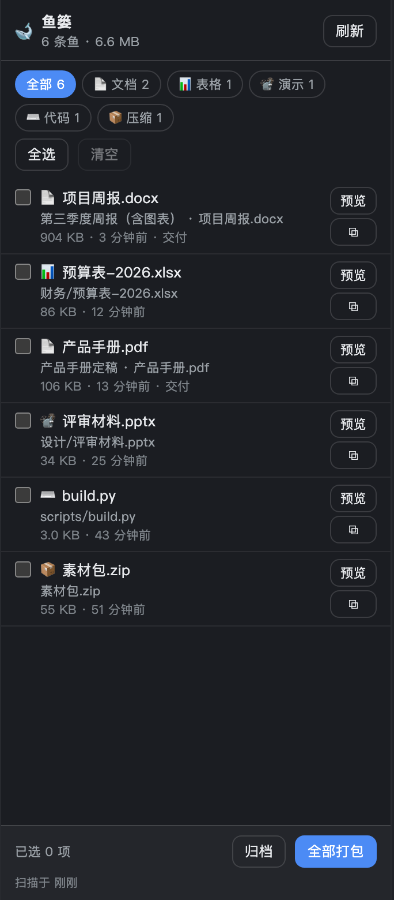

# 🐋 深海鱼篓 · dsh-whale-catch

> **不用登记。** 这次会话里产出的文件，自己游进鱼篓。

[English](README.en.md) | 中文

给 [DeepSeek Harness](https://github.com/deepseek-ai/deepseek-harness)（DSH）的右侧栏插件：把一场会话里**产出或改动的文件**汇总到一个篮子里，预览、看差异、打包 zip、一键归档。

[](https://github.com/Rosynb666/dsh-whale-catch/actions/workflows/ci.yml)
[](https://github.com/Rosynb666/dsh-whale-catch/actions/workflows/release.yml)


-blue)




> 上图是用 `lib/client.js` 里**真实的面板组件** + 示例数据在无头 Chrome 里渲染的静态预览（外面那圈深色栏框是预览页加的），不是 DSH 实机截图；实际配色跟随你的主题。

---

## 它解决什么

在 DSH 里干活，"文件生成完就找不到了"几乎是日常：

- 内核的**产出物卡片**只在当前这一轮出现，往下翻几屏就散了；
- 我在 `bash` 里跑 `python build_doc.py` 写出来的 docx / pdf，既不算"文件工具改动"，也没调 `present`，两套机制都不认；
- 攒了十几个交付物想一次发给别人，只能回目录里翻，还要担心漏掉。

鱼篓只做三件事：**自动收**、**一处看**、**一键打包/归档**；改过的文件还能就地展开差异，不用回 git 里翻。

## 和内核产出物的区别

先说清楚，这不是重复造轮子——内核的 `deliverables/presented` 与 `workspace/changes` 我照单全收，只是它们各自覆盖不到的场景，鱼篓补上：

| | 内核产出物卡片 | 鲸鱼鱼篓 |
|---|---|---|
| 来源 | `present` 声明 + git / 文件工具改动 | 同样两条，**再加目录扫描兜底**（bash、python、构建脚本的产物） |
| 范围 | 单轮，轮末出现 | 整场会话，跨轮聚合 |
| 改动详情 | 轮末卡片里显示一次 | 行数徽章常驻，点开就地看 unified diff，还能按轮分组 |
| 能做什么 | 打开源文件 | 预览 / 看差异 / 打包 zip / 归档到指定目录 / 复制路径 / 复制 Markdown 清单 |
| Host 重启后 | 改动摘要活在内存里，重启即失 | 靠 mtime 重建（`present` 的描述会丢，见[已知限制](#已知限制)） |
| 要不要 agent 配合 | 要模型记得调 `present` | **不要**，零登记 |

## 安装

要求：DSH `>= 0.2.0-rc.2`，Node `^22.19 || >=24`（Desktop 自带运行时已满足）。

```sh
# 从 GitHub 安装
dsh plugin --profile desktop add github:Rosynb666/dsh-whale-catch

# 从 npm 安装
dsh plugin --profile desktop add dsh-whale-catch

# 本地开发：直接用目录
dsh plugin --profile desktop add /绝对路径/dsh-whale-catch
```

刷新页面（⌘R），右侧栏点 `+`，在引导页里选 **「打开深海鱼篓」**，或直接点侧栏里的鱼篓图标。

卸载：

```sh
dsh plugin --profile desktop remove dsh-whale-catch
```

## 界面

右侧栏里的鱼篓（窄栏布局，随主题 token 变色）：

```text
┌──────────────────────────────────────┐
│ 🐋 鱼篓            12 条鱼 · 3.4 MB  [刷新] │
│ [全部 12] [📄 文档 7] [📊 表格 3] [🖼 图片 2] │
├──────────────────────────────────────┤
│ ☑ 📄 项目周报.docx              +12 −3  │
│    第三季度周报 · 周报.docx   [预览] [差异] ⧉ │
│    1.2 MB · 3 分钟前 · 交付 · 改动         │
│ ☐ 📊 预算表-2026.xlsx                  │
│    plan.xlsx · 88 KB · 12 分钟前         │
│ ☐ 🖼 产品手册.pdf                      │
│    ...                                   │
├──────────────────────────────────────┤
│ 已选 2 项                  [归档] [打包 zip] │
│ 扫描于 刚刚                               │
└──────────────────────────────────────┘
```

- **差异** → 对内核记录过的改动就地展开 unified diff（`+` / `−` 着色、加粗的 `@@` 段头），二进制与超大文件给明确提示
- **按轮分组** → 按"第 N 轮"把文件分段，一眼看出每轮产出了什么
- **复制清单** → 把当前列表导成 Markdown（文件名、路径、体积、轮次、行数、描述），贴进周报或 Issue 就能读
- **打包** → zip 里附 `_whale-catch/manifest.json` 与 `交付清单.md`（相对路径、体积、轮次、行数、来源、sha256），不装插件也能看懂这一包是什么
- **勾选** → 只打包选中的；一个都不选就是「全部打包」
- **归档** → 复制到归档目录，保留相对路径，同名文件自动加 `(2)` 不覆盖；cwd 外的文件统一收进 `_external/`
- **预览** → 新标签页打开原文件：图片 / PDF / 文本直接看，Office 走下载
- **⧉** → 复制绝对路径（贴给别的工具最省事）

## 它是怎么"零登记"的

三条来源合并，同一个绝对路径取并集：

| 来源 | 从哪来 | 覆盖什么 |
|---|---|---|
| `presented` | 内核会话事件 `deliverables/presented` | 模型显式交付的文件，带描述与轮次 |
| `changed` | 内核会话事件 `workspace/changes` + `ctx.workspaceChanges.summary()` / `.diff()` | git 快照与文件工具改动，带行数与 unified diff |
| `scanned` | 会话工作目录扫描（mtime ≥ 会话创建时间） | bash / python / 构建脚本写出的文件 |

扫描有边界：只在会话 cwd 内、不跟符号链接、跳过 `node_modules` / `.git` / 点开头目录、受深度 / 数量 / 体积上限约束。细节见 [docs/architecture.md](docs/architecture.md)。

## 配置

用自己的 profile 补丁层覆盖，**不要**改包里的 `cordis.patch.yml`（升级会被覆盖）：

```yaml
# ~/.dsh/profiles/desktop/cordis.patch.yml
- id: dsh-whale-catch
  config:
    archiveDir: ~/Documents/鱼篓归档          # 缺省 $DSH_HOME/whale-catch/archive；~ 会展开
    ignore: [dist, build, .venv]               # 额外忽略的目录名
    maxFiles: 800                              # 最多收录多少个文件
    maxDepth: 6                                # 目录遍历深度
    maxFileBytes: 67108864                     # 单文件上限 64 MB
    lookbackMinutes: 720                       # 拿不到会话创建时间时往回看 12 小时
```

改完热重载即生效，无需重启。

## 安全边界

这些接口跑在本机 `127.0.0.1` 的 Host 上，所以按"浏览器里的第三方页面会来打"来设防：

- **路径白名单**：`/file`、`/diff`、`/zip`、`/archive` 只接受**已经进筐**的路径（Host 内存里的登记表），没有任意文件读取面；`../` 穿越在登记表这一层就被挡掉。`/diff` 还多一道：只对带 `workspace/changes` 记录的条目开放。
- **同源栅栏**：带 `Origin` 且 Host 对不上的请求一律 403；`Sec-Fetch-Site: cross-site` 同样拒绝。
- **写操作必须 `application/json`**：跨站表单发不出这个 content-type，声明了它会触发预检，而预检打到本路由直接被 415 挡掉。
- **内联预览加沙箱**：HTML / SVG 内联出去会继承 Host 源，所以这两类响应带 `Content-Security-Policy: sandbox`——文档照常渲染，脚本不执行、源变 opaque，没法反过来调本机接口。
- **打包与归档的额外校验**：zip 条目名去掉上跳段与前导斜杠；归档写入前再确认目标落在归档根目录内；cwd 之外的文件收进 `_external/`，不镜像绝对路径。
- **硬上限**：单文件 64 MB、打包总量 512 MB、最多 800 个文件、请求体 1 MB，全部可配。超限文件会被跳过，并通过 `X-Whale-Catch-Skipped` 告诉面板跳了几条。

## 已知限制

- 只覆盖**当前会话的工作目录**。跨会话、cwd 之外的文件不进筐（`present` 声明的绝对路径除外）。
- Host 重启后，`present` 的描述与轮次号不会恢复；文件本身会靠 mtime 重新出现。
- mtime 早于会话创建时间的文件不会进筐——"从别处复制进来但保留了旧时间戳"就属于这种。
- **差异只在 Host 存活期间可看**：`workspace-changes` 把对比留在内存里，重启后旧轮次只剩文件名，面板会提示"没有可读的差异"。
- 差异来自内核的 `workspaceChanges.diff()`；宿主版本没有这个能力时，面板同样只给提示，其余功能不受影响。
- `/diff` 一次最多回传 1200 行，面板每条 hunk 最多铺 300 行——长 diff 会被截断并标注。
- 归档目录默认在 `$DSH_HOME` 下，不会自动同步到网盘。
- 预览走浏览器原生能力：PDF / 图片 / 文本能直接看，HTML / SVG 在沙箱里渲染（样式还在，脚本不执行），docx / xlsx 会触发下载（DSH 自带的文档预览更合适，欢迎 PR）。

## 开发

```sh
npm install
npm test        # 50 项：扫描 / 合并 / 改动元数据 / zip 格式 / HTTP 栅栏 / 差异裁剪与超时 / client 注册 / 插件装载
npm run check   # 契约自检（包结构、patch、client.inject、meta、icon、依赖纪律…）
npm run verify  # 两个都跑
```

**没有构建步骤**：`lib/index.js` 是 Host 半边，`lib/client.js` 是原样交给 `__ModuleLoader__` 的浏览器半边，改完直接重装即可。运行时依赖只有 `@deepseek-ai/schemastery`（纯校验库）——它必须是 `dependencies` 而不是 peer：profile 的 pnpm 配置是 `autoInstallPeers: false`，放 peer 在干净 profile 里根本装不上，Host 半边会在加载时直接失败。

```text
dsh-whale-catch/
├── lib/
│   ├── index.js      # 插件入口：会话事件 → 鱼篓登记表，注册 HTTP 路由
│   ├── basket.js     # 三来源合并、改动元数据、快照、路径准入（白名单）
│   ├── scan.js       # 带边界的工作区扫描
│   ├── zip.js        # 零依赖 ZIP 写入器（STORE + DEFLATE）
│   ├── routes.js     # HTTP 接口（含差异裁剪与超时）
│   ├── http.js       # 同源栅栏、JSON 收发、MIME
│   └── client.js     # 右侧栏 tab + 面板（纯 JS，零构建）
├── locale/           # 市场与设置页展示用的元数据
├── test/             # node:test，无测试框架依赖
└── scripts/          # 契约自检
```

架构与不变量：[docs/architecture.md](docs/architecture.md) ·
发布清单：[docs/publish.md](docs/publish.md)

## 许可

[MIT](LICENSE)
